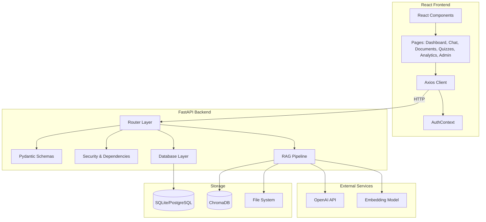
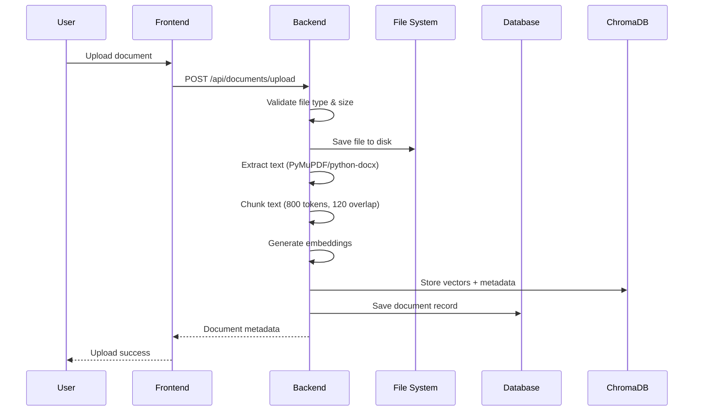
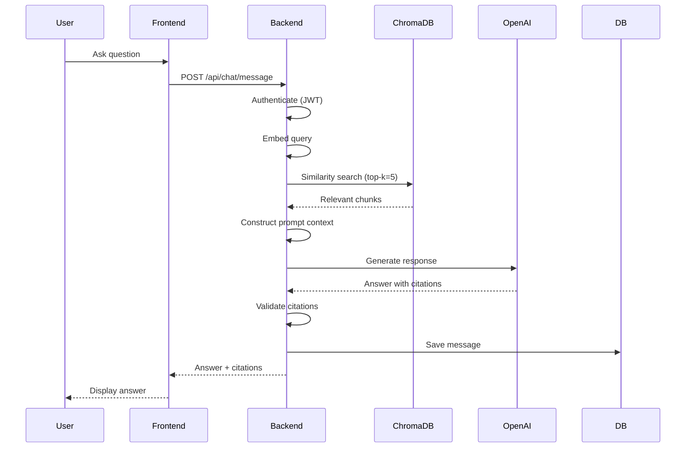
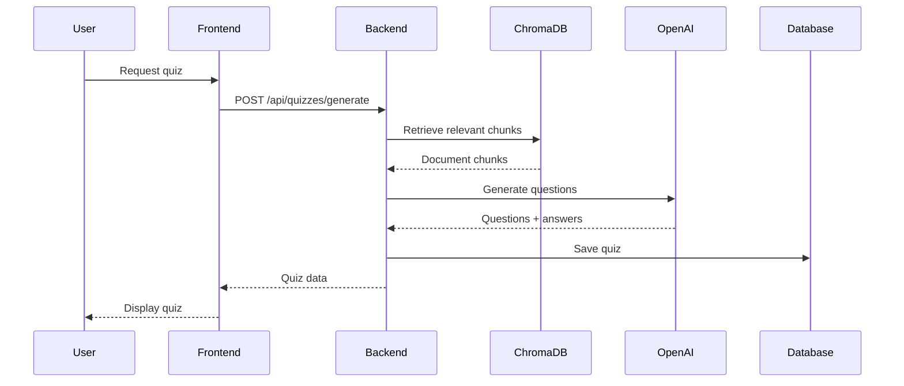
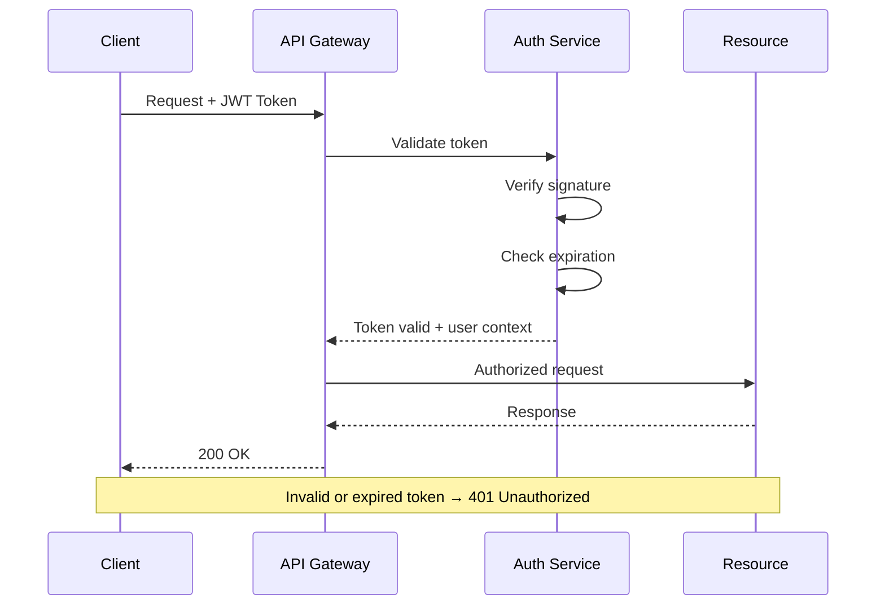
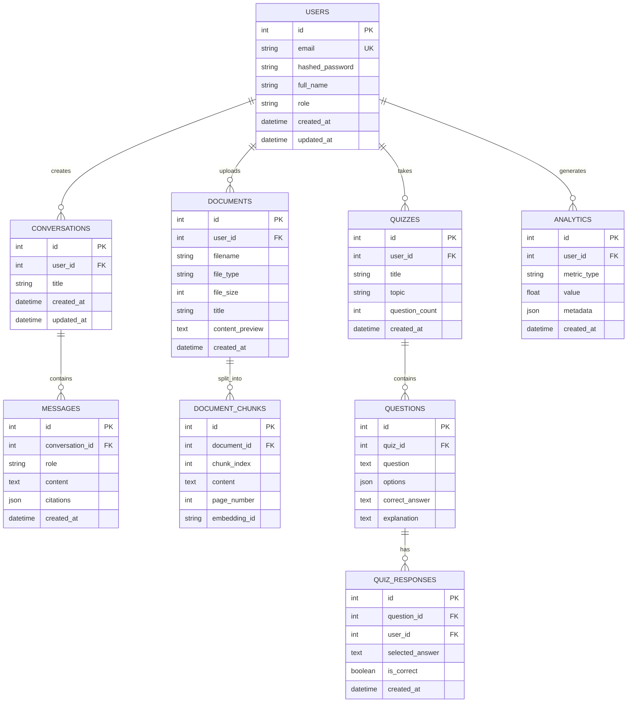

# Architecture

> Comprehensive system architecture documentation for the AI Educational Platform.

---

## Table of Contents

- [System Overview](#system-overview)
- [Component Diagram](#component-diagram)
- [Data Flow](#data-flow)
- [Security Architecture](#security-architecture)
- [Database Schema](#database-schema)
- [API Design Principles](#api-design-principles)
- [Service Boundaries](#service-boundaries)

---

## System Overview

The AI Educational Platform is a full-stack web application built on a **Retrieval-Augmented Generation (RAG)** architecture. It enables students to upload educational documents and interact with an AI tutor that provides grounded, citation-backed answers.

### Design Goals

| Goal | Approach |
|------|----------|
| **Grounded responses** | RAG pipeline ensures all answers derive from uploaded documents |
| **Modularity** | Clear separation between ingestion, retrieval, and generation |
| **Configurability** | Environment-driven settings for embeddings, LLMs, and chunking |
| **Scalability** | Stateless backend services; externalized state in DB and vector store |
| **Developer experience** | Docker Compose, comprehensive tests, OpenAPI docs |

### High-Level Architecture

```
┌─────────────────────────────────────────────────────────────────┐
│                        React SPA (Vite)                         │
│  ┌──────────┐ ┌──────────┐ ┌──────────┐ ┌──────────┐          │
│  │ Dashboard │ │   Chat   │ │ Documents│ │ Analytics│          │
│  └──────────┘ └──────────┘ └──────────┘ └──────────┘          │
└──────────────────────────┬──────────────────────────────────────┘
                           │ HTTP/JSON (Axios)
┌──────────────────────────▼──────────────────────────────────────┐
│                     FastAPI Backend                             │
│  ┌─────────────────────────────────────────────────────────┐    │
│  │                    Routers (API Layer)                   │    │
│  │  auth │ users │ documents │ chat │ quizzes │ analytics  │    │
│  └─────────────────────────┬───────────────────────────────┘    │
│                            │                                    │
│  ┌─────────────────────────▼───────────────────────────────┐    │
│  │                   RAG Pipeline                           │    │
│  │  ingestion → chunking → embeddings → vector_store        │    │
│  │  retrieval → generation → evaluation                    │    │
│  └─────────────────────────┬───────────────────────────────┘    │
│                            │                                    │
│  ┌─────────────────────────▼───────────────────────────────┐    │
│  │              Core Services & Security                    │    │
│  │  security.py │ dependencies.py │ config.py              │    │
│  └─────────────────────────────────────────────────────────┘    │
└──────────┬──────────────────────────────┬───────────────────────┘
           │                              │
┌──────────▼──────────┐      ┌────────────▼────────────┐
│   SQLAlchemy ORM    │      │      ChromaDB            │
│   SQLite/PostgreSQL │      │   (Vector Store)         │
└─────────────────────┘      └─────────────────────────┘
```

---

## Component Diagram



---

## Data Flow

### 1. Document Ingestion Flow



### 2. Chat / Q&A Flow



### 3. Quiz Generation Flow



---

## Security Architecture

### Authentication

| Aspect | Implementation |
|--------|---------------|
| **Token type** | JSON Web Token (JWT) |
| **Algorithm** | HS256 |
| **Token lifetime** | 24 hours (configurable) |
| **Secret key** | Environment variable (`SECRET_KEY`) |
| **Password hashing** | bcrypt via passlib |
| **Token transport** | `Authorization: Bearer <token>` header |

### Authorization

| Role | Permissions |
|------|-------------|
| **Student** | Upload documents, chat, take quizzes, view own analytics |
| **Instructor** | All student permissions + manage course materials |
| **Admin** | All permissions + user management + system analytics |

### Security Measures

- **CORS**: Configured via `FRONTEND_ORIGIN` environment variable
- **Rate limiting**: 60 requests per minute per user (configurable)
- **File validation**: Type checking, size limits (20 MB default)
- **SQL injection prevention**: SQLAlchemy ORM with parameterized queries
- **Input validation**: Pydantic schemas on all endpoints
- **Password security**: bcrypt with salt rounds

### Security Flow



---

## Database Schema

### Entity-Relationship Diagram



### Table Descriptions

#### `users`
Stores all registered users with authentication credentials and role information.

| Column | Type | Constraints |
|--------|------|-------------|
| `id` | Integer | Primary Key, Auto-increment |
| `email` | String | Unique, Not Null |
| `hashed_password` | String | Not Null |
| `full_name` | String | Not Null |
| `role` | String | Default: 'student' |
| `created_at` | DateTime | Auto-set |
| `updated_at` | DateTime | Auto-update |

#### `conversations`
Represents chat conversations between users and the AI tutor.

| Column | Type | Constraints |
|--------|------|-------------|
| `id` | Integer | Primary Key |
| `user_id` | Integer | Foreign Key → users.id |
| `title` | String | Auto-generated or user-set |
| `created_at` | DateTime | Auto-set |
| `updated_at` | DateTime | Auto-update |

#### `messages`
Individual messages within a conversation (both user and assistant).

| Column | Type | Constraints |
|--------|------|-------------|
| `id` | Integer | Primary Key |
| `conversation_id` | Integer | Foreign Key → conversations.id |
| `role` | String | 'user' or 'assistant' |
| `content` | Text | Not Null |
| `citations` | JSON | Array of citation objects |
| `created_at` | DateTime | Auto-set |

#### `documents`
Metadata for uploaded educational documents.

| Column | Type | Constraints |
|--------|------|-------------|
| `id` | Integer | Primary Key |
| `user_id` | Integer | Foreign Key → users.id |
| `filename` | String | Original filename |
| `file_type` | String | 'pdf', 'docx', 'txt' |
| `file_size` | Integer | Size in bytes |
| `title` | String | Extracted or user-provided title |
| `content_preview` | Text | First ~500 characters |
| `created_at` | DateTime | Auto-set |

#### `document_chunks`
Text chunks extracted from documents, linked to vector embeddings.

| Column | Type | Constraints |
|--------|------|-------------|
| `id` | Integer | Primary Key |
| `document_id` | Integer | Foreign Key → documents.id |
| `chunk_index` | Integer | Order within document |
| `content` | Text | Chunk text |
| `page_number` | Integer | Source page (PDF only) |
| `embedding_id` | String | ChromaDB vector ID |

#### `quizzes`
Generated quiz instances.

| Column | Type | Constraints |
|--------|------|-------------|
| `id` | Integer | Primary Key |
| `user_id` | Integer | Foreign Key → users.id |
| `title` | String | Quiz title |
| `topic` | String | Subject/topic |
| `question_count` | Integer | Number of questions |
| `created_at` | DateTime | Auto-set |

#### `questions`
Individual quiz questions.

| Column | Type | Constraints |
|--------|------|-------------|
| `id` | Integer | Primary Key |
| `quiz_id` | Integer | Foreign Key → quizzes.id |
| `question` | Text | Question text |
| `options` | JSON | Array of answer options |
| `correct_answer` | Text | Correct option |
| `explanation` | Text | Why the answer is correct |

#### `quiz_responses`
User answers to quiz questions.

| Column | Type | Constraints |
|--------|------|-------------|
| `id` | Integer | Primary Key |
| `question_id` | Integer | Foreign Key → questions.id |
| `user_id` | Integer | Foreign Key → users.id |
| `selected_answer` | Text | User's choice |
| `is_correct` | Boolean | Whether answer was correct |
| `created_at` | DateTime | Auto-set |

#### `analytics`
Aggregated learning metrics per user.

| Column | Type | Constraints |
|--------|------|-------------|
| `id` | Integer | Primary Key |
| `user_id` | Integer | Foreign Key → users.id |
| `metric_type` | String | e.g., 'quiz_score', 'documents_uploaded' |
| `value` | Float | Metric value |
| `metadata` | JSON | Additional context |
| `created_at` | DateTime | Auto-set |

---

## API Design Principles

### RESTful Conventions

| Principle | Implementation |
|-----------|---------------|
| **Resource naming** | Plural nouns (`/api/documents`, `/api/quizzes`) |
| **HTTP verbs** | GET, POST, PUT, DELETE for CRUD operations |
| **Status codes** | Standard HTTP status codes (200, 201, 400, 401, 404, 500) |
| **Versioning** | URL path versioning (`/api/v1/...`) |
| **Pagination** | `?page=1&page_size=20` query parameters |
| **Filtering** | Query parameters for field-based filtering |
| **Sorting** | `?sort=created_at&order=desc` |

### Response Format

All API responses follow a consistent structure:

```json
{
  "success": true,
  "data": { ... },
  "message": "Operation completed successfully"
}
```

Error responses:

```json
{
  "success": false,
  "error": {
    "code": "VALIDATION_ERROR",
    "message": "Invalid input data",
    "details": [ ... ]
  }
}
```

### Endpoint Categories

| Category | Prefix | Description |
|----------|--------|-------------|
| Authentication | `/api/auth` | Register, login, token refresh |
| Users | `/api/users` | Profile management |
| Documents | `/api/documents` | Upload, list, delete documents |
| Chat | `/api/chat` | Send messages, get responses |
| Conversations | `/api/conversations` | Manage chat conversations |
| Quizzes | `/api/quizzes` | Generate and take quizzes |
| Recommendations | `/api/recommendations` | Personalized suggestions |
| Analytics | `/api/analytics` | Learning metrics and insights |
| Admin | `/api/admin` | Administrative operations |
| Health | `/api/health` | System health check |

---

## Service Boundaries

### Frontend (React SPA)

| Boundary | Responsibility |
|----------|---------------|
| **Presentation** | UI components, layouts, pages |
| **State management** | React Context (AuthContext), local state |
| **API communication** | Axios client with interceptors |
| **Routing** | React Router for navigation |

### Backend (FastAPI)

| Boundary | Responsibility |
|----------|---------------|
| **API layer** | Request routing, validation, serialization |
| **Authentication** | JWT token creation and validation |
| **Authorization** | Role-based access control |
| **Business logic** | Service orchestration, data transformation |
| **Data access** | SQLAlchemy ORM operations |

### RAG Pipeline

| Boundary | Responsibility |
|----------|---------------|
| **Ingestion** | File validation, text extraction, chunking |
| **Embedding** | Vector generation from text chunks |
| **Vector store** | ChromaDB storage and similarity search |
| **Retrieval** | Top-k chunk retrieval with threshold filtering |
| **Generation** | LLM prompt construction and response generation |
| **Evaluation** | Response quality assessment and citation validation |

### External Services

| Service | Purpose |
|---------|---------|
| **OpenAI API** | LLM text generation |
| **Embedding Model** | Text-to-vector conversion (sklearn or Sentence-Transformers) |
| **ChromaDB** | Vector storage and similarity search |

---

<div align="center">

**[Back to Top](#architecture)**

</div>
