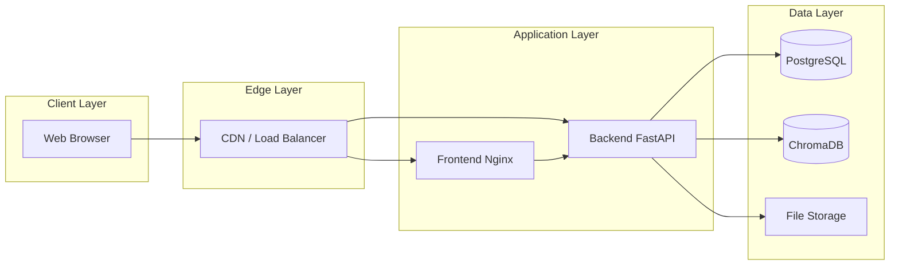
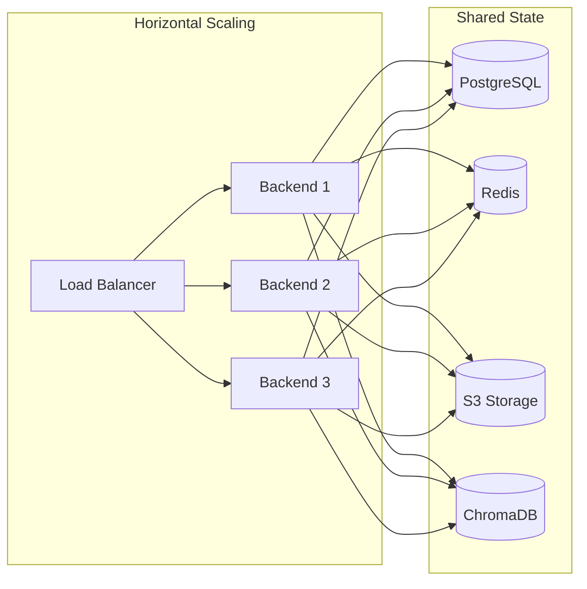

# Deployment Guide

> Comprehensive deployment guide for the AI Educational Platform.

---

## Table of Contents

- [Overview](#overview)
- [Docker Compose Setup](#docker-compose-setup)
- [Environment Variables](#environment-variables)
- [Persistent Storage](#persistent-storage)
- [CORS Configuration](#cors-configuration)
- [Production Considerations](#production-considerations)
- [Hosting Providers](#hosting-providers)
- [Backup Strategies](#backup-strategies)

---

## Overview

The AI Educational Platform can be deployed in various environments, from local development to production cloud infrastructure. This guide covers the recommended approaches.

### Deployment Architecture



---

## Docker Compose Setup

### Basic Production Setup

Create a `docker-compose.prod.yml`:

```yaml
version: "3.8"

services:
  backend:
    build: ./backend
    ports:
      - "8000:8000"
    env_file: .env
    environment:
      - DATABASE_URL=postgresql://ai_edu:${DB_PASSWORD}@db:5432/ai_edu
      - DEBUG=false
    volumes:
      - backend_data:/app/data
      - backend_uploads:/app/data/uploads
    depends_on:
      db:
        condition: service_healthy
    restart: unless-stopped
    healthcheck:
      test: ["CMD", "curl", "-f", "http://localhost:8000/api/health"]
      interval: 30s
      timeout: 10s
      retries: 3

  frontend:
    build: ./frontend
    ports:
      - "80:80"
      - "443:443"
    volumes:
      - ./certs:/etc/nginx/certs:ro
    depends_on:
      - backend
    restart: unless-stopped

  db:
    image: postgres:16-alpine
    environment:
      POSTGRES_DB: ai_edu
      POSTGRES_USER: ai_edu
      POSTGRES_PASSWORD: ${DB_PASSWORD}
    volumes:
      - postgres_data:/var/lib/postgresql/data
    restart: unless-stopped
    healthcheck:
      test: ["CMD-SHELL", "pg_isready -U ai_edu"]
      interval: 10s
      timeout: 5s
      retries: 5

volumes:
  backend_data:
  backend_uploads:
  postgres_data:
```

### Running Production Stack

```bash
# Build and start all services
docker-compose -f docker-compose.yml -f docker-compose.prod.yml up --build -d

# View logs
docker-compose -f docker-compose.yml -f docker-compose.prod.yml logs -f

# Stop all services
docker-compose -f docker-compose.yml -f docker-compose.prod.yml down

# Stop and remove volumes (WARNING: deletes all data)
docker-compose -f docker-compose.yml -f docker-compose.prod.yml down -v
```

---

## Environment Variables

### Production Environment File

```env
# ─── Application ───────────────────────────────────────────────
APP_NAME=AI Educational Platform
DEBUG=false
API_V1_PREFIX=/api

# ─── Database ─────────────────────────────────────────────────
DATABASE_URL=postgresql://ai_edu:your-secure-password@db:5432/ai_edu

# ─── Vector Store ─────────────────────────────────────────────
VECTOR_STORE_PATH=./data/chroma

# ─── Embeddings ───────────────────────────────────────────────
EMBEDDING_PROVIDER=sentence-transformers
EMBEDDING_MODEL=all-MiniLM-L6-v2

# ─── LLM Configuration ────────────────────────────────────────
LLM_PROVIDER=openai
LLM_MODEL=gpt-3.5-turbo
LLM_API_KEY=sk-your-production-key
LLM_BASE_URL=

# ─── RAG Parameters ───────────────────────────────────────────
CHUNK_SIZE=800
CHUNK_OVERLAP=120
RETRIEVAL_TOP_K=5
SIMILARITY_THRESHOLD=0.1

# ─── Authentication ───────────────────────────────────────────
SECRET_KEY=your-very-long-random-secret-key-min-32-chars
ACCESS_TOKEN_EXPIRE_MINUTES=1440
ALGORITHM=HS256

# ─── File Uploads ─────────────────────────────────────────────
MAX_UPLOAD_SIZE_MB=20
UPLOAD_DIR=./data/uploads

# ─── CORS ─────────────────────────────────────────────────────
FRONTEND_ORIGIN=https://yourdomain.com

# ─── Rate Limiting ────────────────────────────────────────────
RATE_LIMIT_PER_MINUTE=60
```

### Variable Reference

| Variable | Required | Default | Description |
|----------|----------|---------|-------------|
| `APP_NAME` | No | AI Educational Platform | Application name |
| `DEBUG` | No | true | Enable debug mode (set false in production) |
| `DATABASE_URL` | Yes | — | Database connection string |
| `VECTOR_STORE_PATH` | No | ./data/chroma | ChromaDB storage path |
| `EMBEDDING_PROVIDER` | No | sklearn | Embedding provider |
| `EMBEDDING_MODEL` | No | tfidf | Embedding model name |
| `LLM_PROVIDER` | Yes | — | LLM provider (openai, mock) |
| `LLM_MODEL` | Yes | — | LLM model identifier |
| `LLM_API_KEY` | Yes* | — | API key for LLM provider |
| `LLM_BASE_URL` | No | — | Custom LLM endpoint |
| `CHUNK_SIZE` | No | 800 | Characters per chunk |
| `CHUNK_OVERLAP` | No | 120 | Overlap between chunks |
| `RETRIEVAL_TOP_K` | No | 5 | Chunks to retrieve |
| `SIMILARITY_THRESHOLD` | No | 0.1 | Minimum similarity score |
| `SECRET_KEY` | Yes | — | JWT signing key |
| `ACCESS_TOKEN_EXPIRE_MINUTES` | No | 1440 | Token lifetime |
| `MAX_UPLOAD_SIZE_MB` | No | 20 | Max file upload size |
| `FRONTEND_ORIGIN` | Yes | — | Allowed CORS origin |
| `RATE_LIMIT_PER_MINUTE` | No | 60 | Rate limit per user |

*Required when `LLM_PROVIDER=openai`

---

## Persistent Storage

### Volume Mapping

| Volume | Container Path | Purpose |
|--------|---------------|---------|
| `backend_data` | `/app/data` | ChromaDB vectors, SQLite DB |
| `backend_uploads` | `/app/data/uploads` | Uploaded documents |
| `postgres_data` | `/var/lib/postgresql/data` | PostgreSQL data |

### Storage Requirements

| Data Type | Growth Rate | Recommended |
|-----------|-------------|-------------|
| Documents | ~1 MB per PDF | SSD, 10+ GB |
| Vectors | ~1 KB per chunk | SSD, 5+ GB |
| Database | ~100 KB per user | SSD, 5+ GB |
| Uploads | Varies by usage | SSD, 20+ GB |

### File System Permissions

```bash
# Ensure proper permissions for data directories
mkdir -p data/uploads data/chroma
chmod 755 data/uploads data/chroma
```

---

## CORS Configuration

### Development

```env
FRONTEND_ORIGIN=http://localhost:5173
```

### Production

```env
FRONTEND_ORIGIN=https://yourdomain.com
```

### Multiple Origins

For multiple allowed origins, modify the CORS middleware in `backend/app/main.py`:

```python
app.add_middleware(
    CORSMiddleware,
    allow_origins=[
        "https://yourdomain.com",
        "https://app.yourdomain.com",
    ],
    allow_credentials=True,
    allow_methods=["*"],
    allow_headers=["*"],
)
```

### CORS Security

| Setting | Development | Production |
|---------|-------------|------------|
| `allow_origins` | `http://localhost:5173` | `https://yourdomain.com` |
| `allow_credentials` | `true` | `true` |
| `allow_methods` | `["*"]` | `["GET", "POST", "PUT", "DELETE"]` |
| `allow_headers` | `["*"]` | `["Authorization", "Content-Type"]` |

---

## Production Considerations

### Security Checklist

- [ ] Change `SECRET_KEY` to a long random string (min 32 characters)
- [ ] Set `DEBUG=false`
- [ ] Use HTTPS with valid SSL certificates
- [ ] Configure proper CORS origins
- [ ] Use PostgreSQL instead of SQLite
- [ ] Enable rate limiting
- [ ] Set up monitoring and alerting
- [ ] Configure log aggregation
- [ ] Use a reverse proxy (Nginx/Traefik)
- [ ] Enable firewall rules
- [ ] Regular security updates

### Performance Optimization

| Area | Recommendation |
|------|---------------|
| **Database** | Use PostgreSQL with connection pooling |
| **Embeddings** | Use Sentence-Transformers for better quality |
| **LLM** | Use gpt-4-turbo for complex queries |
| **Caching** | Add Redis for session and response caching |
| **CDN** | Use CloudFlare or AWS CloudFront for static assets |
| **File Storage** | Use S3-compatible storage for uploads |

### Scaling Strategy



### Monitoring

| Tool | Purpose |
|------|---------|
| **Prometheus** | Metrics collection |
| **Grafana** | Visualization dashboards |
| **Sentry** | Error tracking |
| **Uptime Robot** | Availability monitoring |

### Logging

Configure structured logging in production:

```python
import logging
import json

class JSONFormatter(logging.Formatter):
    def format(self, record):
        return json.dumps({
            "timestamp": self.formatTime(record),
            "level": record.levelname,
            "message": record.getMessage(),
            "module": record.module,
            "function": record.funcName,
        })

handler = logging.StreamHandler()
handler.setFormatter(JSONFormatter())
logging.getLogger().addHandler(handler)
```

---

## Hosting Providers

### Railway

```bash
# Install Railway CLI
npm install -g @railway/cli

# Login and create project
railway login
railway init

# Add PostgreSQL
railway add --plugin postgres

# Deploy
railway up
```

**Pros**: Simple deployment, built-in PostgreSQL, automatic HTTPS
**Cons**: Limited free tier, vendor lock-in

---

### Render

```yaml
# render.yaml
services:
  - type: web
    name: ai-edu-backend
    runtime: python
    buildCommand: pip install -r backend/requirements.txt
    startCommand: uvicorn app.main:app --host 0.0.0.0 --port $PORT
    envVars:
      - key: DATABASE_URL
        fromDatabase:
          name: ai-edu-db
          property: connectionString
      - key: LLM_API_KEY
        sync: false

  - type: web
    name: ai-edu-frontend
    runtime: static
    buildCommand: cd frontend && npm install && npm run build
    staticPublishPath: frontend/dist

databases:
  - name: ai-edu-db
    databaseName: ai_edu
    user: ai_edu
```

**Pros**: Git-based deployment, free tier available, managed PostgreSQL
**Cons**: Cold starts on free tier

---

### AWS (ECS/Fargate)

```bash
# Build and push images
aws ecr get-login-password | docker login --username AWS --password-stdin YOUR_ACCOUNT_ID.dkr.ecr.YOUR_REGION.amazonaws.com

docker build -t ai-edu-backend ./backend
docker tag ai-edu-backend:latest YOUR_ACCOUNT_ID.dkr.ecr.YOUR_REGION.amazonaws.com/ai-edu-backend:latest
docker push YOUR_ACCOUNT_ID.dkr.ecr.YOUR_REGION.amazonaws.com/ai-edu-backend:latest

# Deploy with ECS
aws ecs create-cluster --cluster-name ai-edu
aws ecs register-task-definition --cli-input-json file://aws/task-definition.json
aws ecs create-service --cluster ai-edu --service-name ai-edu-backend --task-definition ai-edu
```

**Pros**: Highly scalable, extensive service ecosystem
**Cons**: Complex setup, higher cost for small projects

---

### Google Cloud Run

```bash
# Build and deploy backend
gcloud run deploy ai-edu-backend \
  --source ./backend \
  --platform managed \
  --region us-central1 \
  --set-env-vars="DATABASE_URL=...,LLM_API_KEY=..."

# Build and deploy frontend
gcloud run deploy ai-edu-frontend \
  --source ./frontend \
  --platform managed \
  --region us-central1
```

**Pros**: Serverless, pay-per-use, automatic scaling
**Cons**: Cold starts, limited control over infrastructure

---

### DigitalOcean App Platform

```yaml
# .do/app.yaml
name: ai-educational-platform
services:
  - name: backend
    github:
      repo: your-org/ai-educational-platform
      branch: main
    source_dir: /backend
    run_command: uvicorn app.main:app --host 0.0.0.0 --port 8080
    envs:
      - key: DATABASE_URL
        scope: RUN_TIME
        value: ${db.DATABASE_URL}
      - key: LLM_API_KEY
        scope: RUN_TIME

  - name: frontend
    github:
      repo: your-org/ai-educational-platform
      branch: main
    source_dir: /frontend
    build_command: npm install && npm run build
    output_directory: dist

databases:
  - name: db
    engine: PG
    version: "16"
```

**Pros**: Simple UI, predictable pricing, managed databases
**Cons**: Less flexible than AWS/GCP

---

### VPS (Self-Hosted)

```bash
# Using Docker Compose on a VPS
ssh user@your-server

# Clone repository
git clone https://github.com/your-org/ai-educational-platform.git
cd ai-educational-platform

# Create environment file
cp .env.example .env
nano .env  # Edit with production values

# Start services
docker-compose -f docker.yml -f docker-compose.prod.yml up -d

# Set up Nginx reverse proxy
sudo apt install nginx
sudo nano /etc/nginx/sites-available/ai-edu

# Enable SSL with Certbot
sudo apt install certbot python3-certbot-nginx
sudo certbot --nginx -d yourdomain.com
```

**Pros**: Full control, cost-effective at scale
**Cons**: Requires DevOps expertise, manual maintenance

---

## Backup Strategies

### Database Backups

#### PostgreSQL (pg_dump)

```bash
# Automated daily backup script
#!/bin/bash
BACKUP_DIR="/backups/postgres"
DATE=$(date +%Y%m%d_%H%M%S)
FILENAME="ai_edu_backup_${DATE}.sql"

mkdir -p ${BACKUP_DIR}

docker exec ai-edu-db pg_dump -U ai_edu ai_edu > ${BACKUP_DIR}/${FILENAME}

# Compress
gzip ${BACKUP_DIR}/${FILENAME}

# Keep only last 7 days
find ${BACKUP_DIR} -name "*.sql.gz" -mtime +7 -delete

# Upload to S3 (optional)
aws s3 sync ${BACKUP_DIR} s3://your-backup-bucket/postgres/
```

#### SQLite (File Copy)

```bash
#!/bin/bash
BACKUP_DIR="/backups/sqlite"
DATE=$(date +%Y%m%d_%H%M%S)

mkdir -p ${BACKUP_DIR}
cp data/app.db ${BACKUP_DIR}/app_${DATE}.db
gzip ${BACKUP_DIR}/app_${DATE}.db

# Keep only last 7 days
find ${BACKUP_DIR} -name "*.db.gz" -mtime +7 -delete
```

### Vector Store Backups

```bash
#!/bin/bash
BACKUP_DIR="/backups/chroma"
DATE=$(date +%Y%m%d_%H%M%S)

mkdir -p ${BACKUP_DIR}
tar -czf ${BACKUP_DIR}/chroma_${DATE}.tar.gz data/chroma/

# Keep only last 7 days
find ${BACKUP_DIR} -name "*.tar.gz" -mtime +7 -delete
```

### Uploaded Files Backup

```bash
#!/bin/bash
BACKUP_DIR="/backups/uploads"
DATE=$(date +%Y%m%d_%H%M%S)

mkdir -p ${BACKUP_DIR}
tar -czf ${BACKUP_DIR}/uploads_${DATE}.tar.gz data/uploads/

# Sync to S3
aws s3 sync ${BACKUP_DIR} s3://your-backup-bucket/uploads/
```

### Backup Schedule

| Data | Frequency | Retention | Storage |
|------|-----------|-----------|---------|
| PostgreSQL | Daily | 7 days local, 30 days S3 | S3 |
| ChromaDB | Daily | 7 days local, 30 days S3 | S3 |
| Uploads | Daily | 30 days | S3 |
| Full system | Weekly | 90 days | S3 Glacier |

### Restore Procedure

```bash
# Restore PostgreSQL
gunzip -c backup_20240115_000000.sql.gz | docker exec -i ai-edu-db psql -U ai_edu ai_edu

# Restore ChromaDB
tar -xzf chroma_20240115_000000.tar.gz -C /app/data/

# Restore Uploads
tar -xzf uploads_20240115_000000.tar.gz -C /app/data/
```

### Backup Verification

```bash
#!/bin/bash
# verify_backup.sh - Run weekly to verify backup integrity

# Test PostgreSQL restore
docker exec ai-edu-db pg_dump -U ai_edu ai_edu | wc -l
# Should return > 0

# Test ChromaDB archive
tar -tzf /backups/chroma/latest.tar.gz | wc -l
# Should return > 0

# Test uploads archive
tar -tzf /backups/uploads/latest.tar.gz | wc -l
# Should return > 0

echo "Backup verification complete: $(date)"
```

---

<div align="center">

**[Back to Top](#deployment-guide)**

</div>
