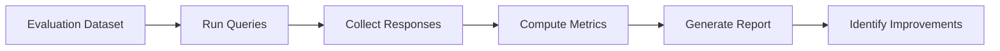
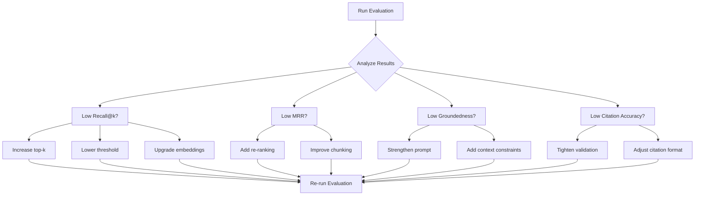

# RAG Evaluation Framework

> Comprehensive evaluation methodology for assessing and improving the RAG pipeline.

---

## Table of Contents

- [Overview](#overview)
- [Evaluation Dataset Format](#evaluation-dataset-format)
- [Metrics](#metrics)
- [Running Evaluations](#running-evaluations)
- [Interpreting Results](#interpreting-results)
- [Reproducibility](#reproducibility)

---

## Overview

The evaluation framework provides systematic methods to measure the quality of the RAG pipeline across multiple dimensions: retrieval accuracy, generation groundedness, and citation validity.

### Evaluation Pipeline



### Module Structure

```
backend/app/rag/evaluation.py
├── compute_recall_at_k()
├── compute_mrr()
├── compute_precision()
├── compute_groundedness()
├── compute_citation_accuracy()
├── run_evaluation()
└── generate_report()
```

---

## Evaluation Dataset Format

### JSON Schema

The evaluation dataset is a JSON file containing query-document-answer triplets:

```json
{
  "version": "1.0",
  "description": "Biology course evaluation queries",
  "queries": [
    {
      "id": "q001",
      "question": "What is the role of mitochondria in the cell?",
      "expected_answer": "Mitochondria generate most of the cell's ATP through oxidative phosphorylation.",
      "relevant_document_ids": [7, 8],
      "relevant_chunk_ids": ["chunk_42", "chunk_15"],
      "difficulty": "easy",
      "topic": "Cell Biology"
    },
    {
      "id": "q002",
      "question": "Explain the process of photosynthesis.",
      "expected_answer": "Photosynthesis converts light energy into chemical energy through light-dependent and light-independent reactions.",
      "relevant_document_ids": [9],
      "relevant_chunk_ids": ["chunk_78"],
      "difficulty": "medium",
      "topic": "Plant Biology"
    }
  ]
}
```

### Dataset Fields

| Field | Type | Required | Description |
|-------|------|----------|-------------|
| `id` | String | Yes | Unique query identifier |
| `question` | String | Yes | The natural language query |
| `expected_answer` | String | Yes | Ground truth answer |
| `relevant_document_ids` | Integer[] | Yes | IDs of documents containing the answer |
| `relevant_chunk_ids` | String[] | Yes | IDs of specific chunks with the answer |
| `difficulty` | String | No | easy, medium, hard |
| `topic` | String | No | Subject category |

### Creating a Dataset

1. **Identify key topics** from your course materials
2. **Write questions** that students would realistically ask
3. **Mark relevant documents** that contain the answer
4. **Identify specific chunks** where the answer can be found
5. **Validate** with domain experts

---

## Metrics

### Recall@k

**Definition**: The proportion of relevant chunks that appear in the top-k retrieved results.

```
Recall@k = |Relevant ∩ Retrieved@k| / |Relevant|
```

**Interpretation**:

| Score | Quality |
|-------|---------|
| 0.90 - 1.00 | Excellent |
| 0.80 - 0.90 | Good |
| 0.70 - 0.80 | Fair |
| < 0.70 | Needs improvement |

**Example**:

```
Relevant chunks: [A, B, C, D]
Retrieved top-5: [A, E, B, F, G]

Recall@5 = |{A, B}| / |{A, B, C, D}| = 2/4 = 0.50
```

---

### Mean Reciprocal Rank (MRR)

**Definition**: The average of reciprocal ranks of the first relevant chunk across all queries.

```
MRR = (1/N) × Σ (1/rank_i)
```

Where `rank_i` is the position of the first relevant chunk for query `i`.

**Interpretation**:

| Score | Quality |
|-------|---------|
| 0.90 - 1.00 | Excellent |
| 0.75 - 0.90 | Good |
| 0.50 - 0.75 | Fair |
| < 0.50 | Needs improvement |

**Example**:

```
Query 1: First relevant chunk at rank 1 → RR = 1.0
Query 2: First relevant chunk at rank 3 → RR = 0.33
Query 3: First relevant chunk at rank 2 → RR = 0.50

MRR = (1.0 + 0.33 + 0.50) / 3 = 0.61
```

---

### Precision

**Definition**: The proportion of retrieved chunks that are actually relevant.

```
Precision@k = |Relevant ∩ Retrieved@k| / |Retrieved@k|
```

**Interpretation**:

| Score | Quality |
|-------|---------|
| 0.85 - 1.00 | Excellent |
| 0.70 - 0.85 | Good |
| 0.50 - 0.70 | Fair |
| < 0.50 | Needs improvement |

**Example**:

```
Retrieved top-5: [A, E, B, F, G]
Relevant chunks: [A, B, C, D]

Precision@5 = |{A, B}| / |{A, E, B, F, G}| = 2/5 = 0.40
```

---

### Groundedness

**Definition**: The proportion of the generated answer that is supported by the retrieved context.

```
Groundedness = (Number of supported claims) / (Total number of claims)
```

**Scoring**:

| Score | Quality |
|-------|---------|
| 0.95 - 1.00 | Excellent |
| 0.90 - 0.95 | Good |
| 0.80 - 0.90 | Fair |
| < 0.80 | Needs improvement |

**Method**: Each sentence or claim in the response is checked against the retrieved context. A claim is "supported" if it can be traced to specific text in the context.

---

### Citation Accuracy

**Definition**: The proportion of citations in the response that correctly reference retrieved chunks.

```
Citation Accuracy = (Valid citations) / (Total citations)
```

**Scoring**:

| Score | Quality |
|-------|---------|
| 0.98 - 1.00 | Excellent |
| 0.95 - 0.98 | Good |
| 0.90 - 0.95 | Fair |
| < 0.90 | Needs improvement |

**Validation Rules**:

1. Citation index must correspond to a retrieved chunk
2. Document title must match the source document
3. Page number must be within the document's page range
4. Chunk content must support the cited claim

---

### Metric Summary

| Metric | Measures | Target | Priority |
|--------|----------|--------|----------|
| **Recall@k** | Retrieval completeness | > 0.85 | High |
| **MRR** | Retrieval ranking quality | > 0.75 | High |
| **Precision** | Retrieval noise level | > 0.70 | Medium |
| **Groundedness** | Answer faithfulness | > 0.90 | Critical |
| **Citation Accuracy** | Reference validity | > 0.95 | Critical |

---

## Running Evaluations

### Command Line

```bash
cd backend

# Run full evaluation
python -m app.rag.evaluation \
  --dataset data/eval/queries.json \
  --output results/eval_report.json

# Run with specific metrics
python -m app.rag.evaluation \
  --dataset data/eval/queries.json \
  --metrics recall@k,mrr,groundedness \
  --output results/eval_report.json

# Run with custom parameters
python -m app.rag.evaluation \
  --dataset data/eval/queries.json \
  --top-k 5 \
  --threshold 0.1 \
  --output results/eval_report.json
```

### Programmatic Usage

```python
from app.rag.evaluation import run_evaluation

results = run_evaluation(
    dataset_path="data/eval/queries.json",
    top_k=5,
    similarity_threshold=0.1,
    metrics=["recall@k", "mrr", "precision", "groundedness", "citation_accuracy"]
)

print(f"Recall@5: {results['recall_at_k']:.2f}")
print(f"MRR: {results['mrr']:.2f}")
print(f"Groundedness: {results['groundedness']:.2f}")
```

### Evaluation Configuration

```env
# Evaluation settings
EVAL_DATASET_PATH=./data/eval/queries.json
EVAL_OUTPUT_PATH=./data/eval/results.json
EVAL_TOP_K=5
EVAL_SIMILARITY_THRESHOLD=0.1
EVAL_TEMPERATURE=0.3
```

---

## Interpreting Results

### Report Format

```json
{
  "metadata": {
    "timestamp": "2024-01-15T10:30:00Z",
    "dataset_version": "1.0",
    "total_queries": 50,
    "config": {
      "top_k": 5,
      "similarity_threshold": 0.1,
      "embedding_model": "tfidf",
      "llm_model": "gpt-3.5-turbo"
    }
  },
  "summary": {
    "recall_at_k": 0.87,
    "mrr": 0.78,
    "precision": 0.72,
    "groundedness": 0.93,
    "citation_accuracy": 0.97
  },
  "per_query": [
    {
      "query_id": "q001",
      "question": "What is the role of mitochondria?",
      "recall_at_k": 1.0,
      "mrr": 1.0,
      "precision": 0.6,
      "groundedness": 1.0,
      "citation_accuracy": 1.0
    }
  ],
  "by_difficulty": {
    "easy": { "recall_at_k": 0.92, "mrr": 0.85 },
    "medium": { "recall_at_k": 0.84, "mrr": 0.74 },
    "hard": { "recall_at_k": 0.78, "mrr": 0.68 }
  },
  "by_topic": {
    "Cell Biology": { "recall_at_k": 0.90, "mrr": 0.82 },
    "Genetics": { "recall_at_k": 0.82, "mrr": 0.71 }
  }
}
```

### Decision Matrix

| Issue | Metric | Action |
|-------|--------|--------|
| Missing relevant chunks | Low Recall@k | Increase top-k, lower threshold, improve embeddings |
| Relevant chunks ranked low | Low MRR | Improve embedding quality, add re-ranking |
| Too many irrelevant chunks | Low Precision | Increase threshold, improve chunking |
| Hallucinated content | Low Groundedness | Strengthen system prompt, add context constraints |
| Invalid citations | Low Citation Accuracy | Improve citation validation, adjust prompt |

### Improvement Workflow



---

## Reproducibility

### Version Control

Track all evaluation artifacts in version control:

```
data/eval/
├── queries.json              # Evaluation dataset
├── results/
│   ├── eval_2024-01-15.json   # Daily evaluation results
│   └── eval_2024-01-16.json
└── README.md                 # Dataset documentation
```

### Configuration Locking

Record the exact configuration used for each evaluation:

```json
{
  "config": {
    "embedding_provider": "sklearn",
    "embedding_model": "tfidf",
    "llm_provider": "openai",
    "llm_model": "gpt-3.5-turbo",
    "chunk_size": 800,
    "chunk_overlap": 120,
    "top_k": 5,
    "similarity_threshold": 0.1,
    "temperature": 0.3
  }
}
```

### Automated Evaluation

Add evaluation to your CI/CD pipeline:

```yaml
# .github/workflows/evaluation.yml
name: RAG Evaluation

on:
  push:
    paths:
      - 'backend/app/rag/**'
      - 'data/eval/**'

jobs:
  evaluate:
    runs-on: ubuntu-latest
    steps:
      - uses: actions/checkout@v4
      - name: Set up Python
        uses: actions/setup-python@v5
        with:
          python-version: '3.11'
      - name: Install dependencies
        run: pip install -r backend/requirements.txt
      - name: Run evaluation
        run: |
          cd backend
          python -m app.rag.evaluation \
            --dataset data/eval/queries.json \
            --output results/eval_report.json
      - name: Check thresholds
        run: |
          python -c "
          import json
          with open('backend/results/eval_report.json') as f:
              results = json.load(f)
          assert results['summary']['recall_at_k'] >= 0.80, 'Recall below threshold'
          assert results['summary']['groundedness'] >= 0.90, 'Groundedness below threshold'
          "
```

### Best Practices

1. **Run evaluations on every change** to the RAG pipeline
2. **Track metrics over time** to identify regressions
3. **Version your datasets** alongside code changes
4. **Document configuration** for each evaluation run
5. **Set minimum thresholds** and fail CI when metrics drop
6. **Compare embedding models** using the same dataset
7. **Review individual query results** to identify patterns

---

<div align="center">

**[Back to Top](#rag-evaluation-framework)**

</div>
