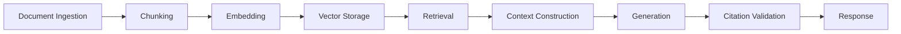
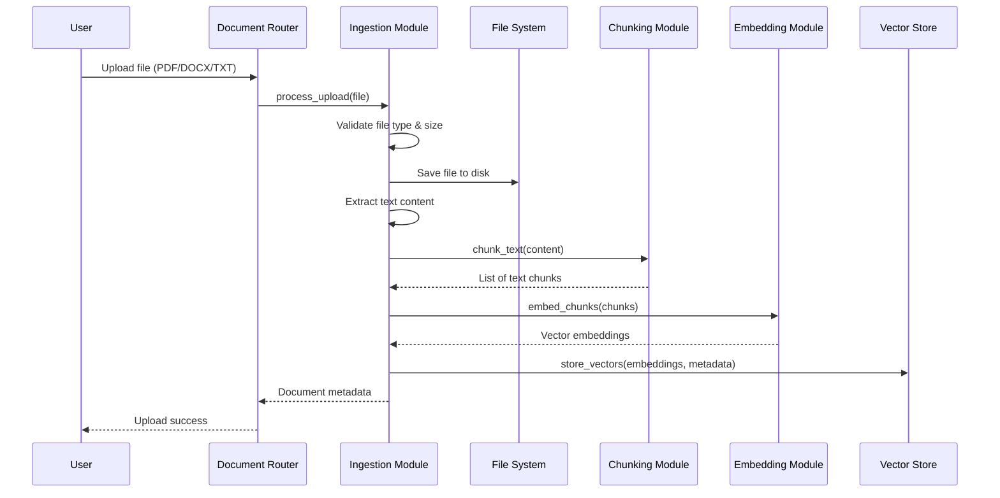
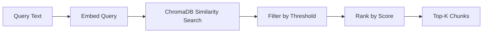
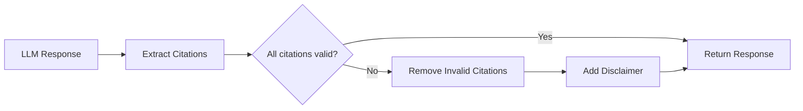

# RAG Pipeline

> Deep dive into the Retrieval-Augmented Generation pipeline that powers the AI Educational Platform.

---

## Table of Contents

- [Overview](#overview)
- [Ingestion Pipeline](#ingestion-pipeline)
- [Chunking Strategy](#chunking-strategy)
- [Embedding Options](#embedding-options)
- [Retrieval Algorithm](#retrieval-algorithm)
- [Context Construction](#context-construction)
- [Generation Process](#generation-process)
- [Citation Validation](#citation-validation)
- [Evaluation Methodology](#evaluation-methodology)

---

## Overview

The RAG (Retrieval-Augmented Generation) pipeline is the core intelligence of the platform. It transforms static educational documents into a dynamic knowledge base that the LLM can query to produce grounded, citation-backed answers.

### Pipeline Stages



### Module Structure

```
backend/app/rag/
├── ingestion.py      # File validation, text extraction, orchestration
├── chunking.py       # Text splitting with configurable parameters
├── embeddings.py     # Embedding generation (sklearn, sentence-transformers)
├── vector_store.py   # ChromaDB wrapper for vector operations
├── retrieval.py      # Similarity search and top-k selection
├── generation.py     # LLM prompt construction and response generation
├── evaluation.py     # Response quality metrics and citation validation
└── __init__.py
```

---

## Ingestion Pipeline

### Step-by-Step Process



### File Validation

| Check | Parameter | Default |
|-------|-----------|---------|
| File type | Allowed extensions | `.pdf`, `.docx`, `.txt` |
| File size | Maximum upload size | 20 MB |
| File integrity | Non-empty content | Required |
| Duplicate detection | Same filename for user | Optional |

### Text Extraction

| Format | Library | Method |
|--------|---------|--------|
| PDF | PyMuPDF (`fitz`) | `page.get_text()` per page |
| DOCX | python-docx | `paragraph.text` for each paragraph |
| TXT | Standard I/O | Direct file read |

### Error Handling

- **Unsupported format**: Returns `400 Bad Request` with supported formats list
- **File too large**: Returns `413 Payload Too Large`
- **Empty content**: Returns `422 Unprocessable Entity`
- **Corrupted file**: Returns `422 Unprocessable Entity` with extraction error details

---

## Chunking Strategy

### Configuration

| Parameter | Default | Description |
|-----------|---------|-------------|
| `CHUNK_SIZE` | 800 | Maximum characters per chunk |
| `CHUNK_OVERLAP` | 120 | Overlapping characters between adjacent chunks |

### Chunking Algorithm

The chunking module uses a **sliding window** approach with overlap to preserve context across chunk boundaries:

```python
def chunk_text(text: str, chunk_size: int = 800, overlap: int = 120) -> list[Chunk]:
    """
    Split text into overlapping chunks.

    Args:
        text: The full text to chunk
        chunk_size: Maximum characters per chunk
        overlap: Number of overlapping characters between chunks

    Returns:
        List of Chunk objects with content, index, and page metadata
    """
    chunks = []
    start = 0
    index = 0

    while start < len(text):
        end = start + chunk_size
        chunk_content = text[start:end]

        chunks.append(Chunk(
            content=chunk_content,
            index=index,
            page_number=estimate_page(start)
        ))

        start = end - overlap
        index += 1

    return chunks
```

### Chunk Metadata

Each chunk carries metadata essential for retrieval and citation:

| Field | Type | Description |
|-------|------|-------------|
| `content` | String | The chunk text |
| `index` | Integer | Position within the document |
| `page_number` | Integer | Source page (PDF only) |
| `document_id` | Integer | Parent document ID |
| `embedding_id` | String | ChromaDB vector identifier |

### Chunking Best Practices

- **Overlap prevents context loss**: The 120-character overlap ensures that sentences split across chunk boundaries are still retrievable in context.
- **Size trade-off**: Smaller chunks improve precision but may lose context; larger chunks preserve context but may dilute relevance.
- **Page tracking**: For PDFs, page numbers are estimated based on character position to support page-level citations.

---

## Embedding Options

### Provider Comparison

| Provider | Model | Speed | Quality | Setup |
|----------|-------|-------|---------|-------|
| **scikit-learn** | TF-IDF | Fast | Good | No external dependencies |
| **Sentence-Transformers** | all-MiniLM-L6-v2 | Medium | Excellent | Requires model download |
| **Sentence-Transformers** | all-mpnet-base-v2 | Slow | State-of-the-art | Requires model download |

### Configuration

```env
# Fast, lightweight (default for development)
EMBEDDING_PROVIDER=sklearn
EMBEDDING_MODEL=tfidf

# High quality (recommended for production)
EMBEDDING_PROVIDER=sentence-transformers
EMBEDDING_MODEL=all-MiniLM-L6-v2
```

### scikit-learn (TF-IDF)

```python
from sklearn.feature_extraction.text import TfidfVectorizer

class SklearnEmbedder:
    def __init__(self):
        self.vectorizer = TfidfVectorizer(
            max_features=384,
            stop_words='english'
        )

    def embed(self, texts: list[str]) -> list[list[float]]:
        """Convert texts to TF-IDF vectors."""
        return self.vectorizer.fit_transform(texts).toarray().tolist()
```

**Pros**: No model download, fast inference, low memory
**Cons**: No semantic understanding, keyword-based matching only

### Sentence-Transformers

```python
from sentence_transformers import SentenceTransformer

class SentenceTransformerEmbedder:
    def __init__(self, model_name: str = "all-MiniLM-L6-v2"):
        self.model = SentenceTransformer(model_name)

    def embed(self, texts: list[str]) -> list[list[float]]:
        """Convert texts to dense vector embeddings."""
        return self.model.encode(texts, show_progress_bar=False).tolist()
```

**Pros**: Semantic understanding, cross-lingual support, high retrieval quality
**Cons**: Model download (~80MB), higher memory usage, slower inference

### Embedding Storage

Embeddings are stored in ChromaDB with the following structure:

```json
{
  "id": "chunk_42",
  "embedding": [0.0123, -0.0456, ...],
  "metadata": {
    "document_id": 7,
    "document_title": "Biology Chapter 3",
    "chunk_index": 3,
    "page_number": 12,
    "file_type": "pdf"
  },
  "document": "The mitochondria is the powerhouse of the cell..."
}
```

---

## Retrieval Algorithm

### Similarity Search

The retrieval module uses **cosine similarity** to find the most relevant chunks:

```python
def retrieve(
    query_embedding: list[float],
    top_k: int = 5,
    similarity_threshold: float = 0.1
) -> list[RetrievedChunk]:
    """
    Retrieve top-k most similar chunks from the vector store.

    Args:
        query_embedding: The embedded query vector
        top_k: Maximum number of chunks to retrieve
        similarity_threshold: Minimum similarity score (0-1)

    Returns:
        Filtered and ranked list of retrieved chunks
    """
    results = vector_store.similarity_search(
        query_embedding=query_embedding,
        k=top_k
    )

    # Filter by similarity threshold
    filtered = [
        chunk for chunk in results
        if chunk.similarity_score >= similarity_threshold
    ]

    return filtered
```

### Retrieval Parameters

| Parameter | Default | Description |
|-----------|---------|-------------|
| `RETRIEVAL_TOP_K` | 5 | Number of chunks to retrieve |
| `SIMILARITY_THRESHOLD` | 0.1 | Minimum cosine similarity score |

### Retrieval Flow



### Similarity Score Interpretation

| Score Range | Interpretation |
|-------------|---------------|
| 0.8 - 1.0 | Highly relevant |
| 0.5 - 0.8 | Moderately relevant |
| 0.3 - 0.5 | Somewhat relevant |
| 0.1 - 0.3 | Marginally relevant |
| < 0.1 | Filtered out (below threshold) |

---

## Context Construction

### Prompt Assembly

Retrieved chunks are assembled into a structured prompt context:

```python
def construct_context(retrieved_chunks: list[RetrievedChunk]) -> str:
    """
    Build a context string from retrieved chunks.
    """
    context_parts = []

    for i, chunk in enumerate(retrieved_chunks, 1):
        context_parts.append(
            f"[Source {i}] "
            f"Document: {chunk.document_title} | "
            f"Page: {chunk.page_number}\n"
            f"{chunk.content}\n"
        )

    return "\n\n".join(context_parts)
```

### System Prompt

The generation module uses a system prompt that enforces grounded responses:

```
You are an AI tutor for the AI Educational Platform.

RULES:
1. Answer ONLY using the provided source materials.
2. If the answer is not in the sources, say "I don't have enough information to answer that question."
3. Always cite sources using [Source N] notation.
4. Be clear, concise, and educational.
5. Use markdown formatting for readability.

SOURCES:
{context}

STUDENT QUESTION:
{question}
```

### Context Window Management

| LLM Model | Max Tokens | Recommended Chunks |
|-----------|-----------|-------------------|
| gpt-3.5-turbo | 16,385 | 5-8 chunks |
| gpt-4 | 8,192 | 4-6 chunks |
| gpt-4-turbo | 128,000 | 10-15 chunks |

If the total context exceeds the model's token limit, chunks are truncated starting from the lowest-scoring chunk.

---

## Generation Process

### LLM Call

```python
def generate_response(
    question: str,
    context: str,
    conversation_history: list[dict] = None
) -> GenerationResult:
    """
    Generate a grounded response using the LLM.
    """
    messages = [
        {"role": "system", "content": build_system_prompt(context)},
    ]

    # Add conversation history for context
    if conversation_history:
        messages.extend(conversation_history[-6:])  # Last 3 exchanges

    messages.append({"role": "user", "content": question})

    response = llm_client.chat.completions.create(
        model=settings.LLM_MODEL,
        messages=messages,
        temperature=0.3,  # Low temperature for factual responses
        max_tokens=1024
    )

    return GenerationResult(
        answer=response.choices[0].message.content,
        citations=extract_citations(response.choices[0].message.content),
        token_usage=response.usage
    )
```

### Generation Parameters

| Parameter | Value | Rationale |
|-----------|-------|-----------|
| `temperature` | 0.3 | Low temperature for factual, deterministic responses |
| `max_tokens` | 1024 | Sufficient for detailed answers with citations |
| `top_p` | 1.0 | No nucleus sampling (default) |
| `frequency_penalty` | 0.0 | No penalty (default) |
| `presence_penalty` | 0.0 | No penalty (default) |

### Response Format

The LLM is instructed to return answers in the following format:

```markdown
The mitochondria is known as the powerhouse of the cell because it generates
most of the cell's ATP through oxidative phosphorylation [Source 1].

Key functions include:
- ATP production via the electron transport chain [Source 1]
- Regulation of cellular metabolism [Source 2]
- Calcium signaling [Source 2]

**Sources:**
- [Source 1] Biology Chapter 3, Page 12
- [Source 2] Cell Biology Textbook, Page 45
```

---

## Citation Validation

### Why Citation Validation Matters

LLMs may hallucinate citations that don't correspond to actual retrieved chunks. The citation validation step ensures that every reference in the response maps to a real source.

### Validation Algorithm

```python
def validate_citations(
    response: str,
    retrieved_chunks: list[RetrievedChunk]
) -> ValidationResult:
    """
    Validate that all citations in the response correspond to retrieved chunks.
    """
    # Extract citation references from response
    cited_indices = extract_citation_indices(response)  # [1, 2, 3]

    # Map to valid chunk indices
    valid_indices = set(range(1, len(retrieved_chunks) + 1))

    # Find invalid citations
    invalid_citations = [
        idx for idx in cited_indices
        if idx not in valid_indices
    ]

    # Remove invalid citations from response
    cleaned_response = remove_invalid_citations(response, invalid_citations)

    return ValidationResult(
        is_valid=len(invalid_citations) == 0,
        cleaned_response=cleaned_response,
        invalid_citations=invalid_citations
    )
```

### Validation Flow



### Citation Format

| Format | Example |
|--------|---------|
| Inline | `...as described in the textbook [Source 1]...` |
| Footnote | `...mitochondria produce ATP [1].` with `**Sources:**` section |

---

## Evaluation Methodology

### Evaluation Metrics

See [`docs/evaluation.md`](evaluation.md) for the complete evaluation framework.

### Quick Reference

| Metric | Description | Target |
|--------|-------------|--------|
| **Recall@k** | Proportion of relevant chunks retrieved | > 0.85 |
| **MRR** | Mean Reciprocal Rank of first relevant chunk | > 0.75 |
| **Precision** | Proportion of retrieved chunks that are relevant | > 0.70 |
| **Groundedness** | Proportion of answer supported by sources | > 0.90 |
| **Citation Accuracy** | Proportion of citations that are valid | > 0.95 |

### Running Evaluations

```bash
cd backend
python -m app.rag.evaluation --dataset data/eval/queries.json
```

---

<div align="center">

**[Back to Top](#rag-pipeline)**

</div>
